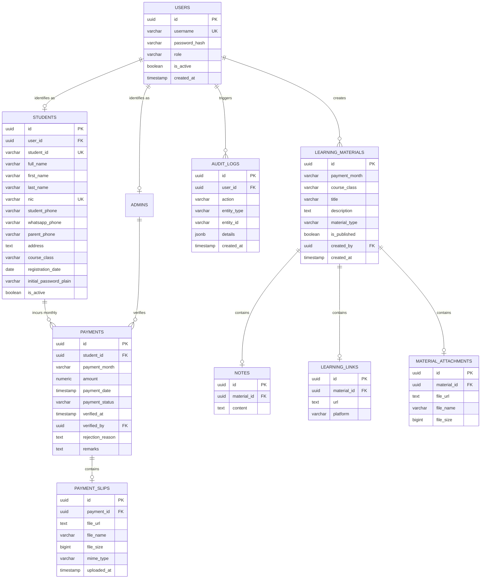
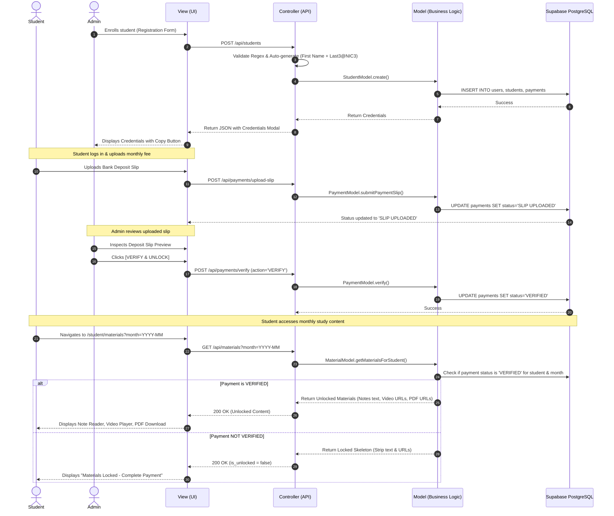

# IT 403061 – Enterprise Systems Technologies and Architectures
## Individual Assignment: Web-Based Tuition Class Student Management & Learning Management System (LMS)

---

### 1. Introduction
Modern educational environments demand secure, reliable, and high-performance enterprise platforms to manage tuition registrations, handle monthly fee verification, and dispense academic learning content. This project implements a full-stack, enterprise-grade **Tuition Class Student Management and Learning Management System (LMS)** specifically engineered to fulfill the requirements of **IT 403061 – Enterprise Systems Technologies and Architectures**.

---

### 2. System Domain & Context
The system domain is **Tuition Class Student Management and Learning Management System**. Designed for private tuition teachers and tuition institutes, it orchestrates the end-to-end academic cycle:
- **Tuition Master / Administrator**: Enrolls students, oversees auto-generated login credentials, inspects bank deposit slips, verifies tuition payments, publishes structured monthly lecture notes, video recordings, and worksheet attachments, and analyzes financial reports.
- **Students**: Log in with personalized credentials, review academic profiles, upload monthly payment receipts, monitor verification status, and access unlocked monthly study materials.

---

### 3. Problem Statement & Motivation
Traditional tuition class management relies on manual physical attendance cards, scattered WhatsApp slips, and unverified distribution of intellectual course materials. This causes:
1. **Uncontrolled Material Access**: Unpaid students accessing lesson recordings and PDF notes.
2. **Payment Verification Bottlenecks**: Time-consuming manual slip verification and lost deposit receipts.
3. **Weak Access Governance**: Lack of unified role-based access and audit trails.

---

### 4. Objectives
1. Implement a **strict Model-View-Controller (MVC)** software architecture.
2. Automate student credential generation using predefined institutional formulas.
3. Enforce **backend-level monthly payment access control**, ensuring lecture content remains inaccessible until payment verification is approved.
4. Integrate with **Supabase PostgreSQL & Supabase Storage** with Row Level Security (RLS).
5. Deliver a responsive, modern web application ready for single-click deployment on **Vercel**.

---

### 5. Architectural Pattern – Model-View-Controller (MVC)

The application strictly enforces separation of concerns across three distinct layers:

```
                      ┌────────────────────────────────────────┐
                      │                 CLIENT                 │
                      │    (Browser: Desktop, Tablet, Mobile)  │
                      └──────────────────┬─────────────────────┘
                                         │  HTTP / JSON
                                         ▼
┌───────────────────────────────────────────────────────────────────────────────────┐
│                                 CONTROLLER LAYER                                  │
│   src/controllers/                                                                │
│   - AuthController: Login, logout, JWT session creation, credential verification │
│   - StudentController: Regex validation, duplicate checks, credential generator   │
│   - PaymentController: Slip upload validator, admin verification/rejection flows │
│   - MaterialController: Monthly access gatekeeper, Link/Note/File CRUD            │
│   - ReportController: Financial analytics aggregation & CSV exporter             │
└───────────────────────┬───────────────────────────────────▲───────────────────────┘
                        │                                   │
              Dispatches│Requests                 Aggregates│Data / View Models
                        ▼                                   │
┌───────────────────────────────────────────┐       ┌───────┴───────────────────────┐
│                MODEL LAYER                │       │          VIEW LAYER           │
│   src/models/                             │       │   src/views/ & src/app/       │
│   - UserModel: Auth data access           │       │   - LoginView                 │
│   - StudentModel: Registration & profiles │       │   - AdminDashboardView        │
│   - PaymentModel: Statuses & slip storage │       │   - StudentRegisterView       │
│   - MaterialModel: Access control checks  │       │   - PaymentVerificationView   │
│   - AuditModel: Enterprise audit trail    │       │   - MaterialManagerView       │
│   - ReportModel: KPIs & summary reports   │       │   - StudentMaterialsView      │
│   - db.ts / Supabase Client & RLS         │       │   - StudentPaymentView        │
└─────────────────────┬─────────────────────┘       └───────────────────────────────┘
                      │ SQL / RLS
                      ▼
┌───────────────────────────────────────────────────┐
│               PERSISTENCE LAYER                   │
│   - Supabase PostgreSQL Database (10 Tables)      │
│   - Supabase Storage Buckets (payment-slips, etc.)│
└───────────────────────────────────────────────────┘
```

#### Detailed Layer Responsibilities:
1. **Model Layer (`src/models/`)**:
   - Manages state, executes relational queries against Supabase PostgreSQL, enforces database constraints, and computes core domain rules (such as checking whether a student has paid for a specific month before releasing material payloads).
2. **View Layer (`src/views/` & `src/app/`)**:
   - Pure presentation components (React, Tailwind CSS, Lucide icons). Never issues raw database queries. Receives structured state and dispatches user actions to controllers.
3. **Controller Layer (`src/controllers/`)**:
   - Intermediary orchestrator. Validates incoming requests against regex schemas, invokes model functions, signs JWT tokens, handles error responses, and returns clean HTTP responses.

---

### 6. Functional Requirements Breakdown

| FR ID | Requirement | User Role | Input Data | Process & Logic | Output | MVC Mapping |
|:---|:---|:---|:---|:---|:---|:---|
| **FR01** | Admin Login | Admin | Username, Password | Authenticates against `users` table where `role='ADMIN'`. Validates bcrypt hash. Issues JWT cookie. | Redirects to `/admin` Dashboard | **M**: `UserModel`<br>**V**: `LoginView`<br>**C**: `AuthController` |
| **FR02** | Student Registration | Admin | ID, Name, NIC, Phones, Address, Class | Validates fields via regex (`NIC_REGEX`, `PHONE_REGEX`), triggers FR03 & FR04, checks duplicates, saves record. | Created Student Record + Credential Card | **M**: `StudentModel`<br>**V**: `StudentRegisterView`<br>**C**: `StudentController` |
| **FR03** | Auto Username Generation | System | Student First Name | Sanitizes and extracts First Name (e.g. "Kavindu"). | Unique Username | **M**: `StudentModel`<br>**C**: `StudentController` / `auth.ts` |
| **FR04** | Auto Password Generation | System | Last Name, NIC Number | Extracts Last 3 chars of Last Name + "@" + First 3 digits of NIC (e.g. `Silpage` + `200012345678` -> `age@200`). Hashes with bcrypt. | Plain Password (displayed to admin once) & Hash | **M**: `StudentModel`<br>**C**: `StudentController` / `auth.ts` |
| **FR05** | Student Login | Student | Username, Password | Verifies student username & password. Checks active status. Signs session token. | Redirects to `/student` Portal | **M**: `UserModel`<br>**V**: `LoginView`<br>**C**: `AuthController` |
| **FR06** | Student Profile View | Student | Session Token | Retrieves student profile by authenticated `user_id`. Prevents cross-student access. | Profile Overview Screen | **M**: `StudentModel`<br>**V**: `StudentProfileView`<br>**C**: `StudentController` |
| **FR07** | Monthly Payment System | Admin / Student | Month Code (`YYYY-MM`), Amount | Tracks monthly tuition obligations. Initializes unpaid records. | Monthly Payment Schedule | **M**: `PaymentModel`<br>**V**: `StudentPaymentView`<br>**C**: `PaymentController` |
| **FR08** | Payment Slip Upload | Student | Month, Image/PDF File | Validates file type (JPG/PNG/PDF) & size (<5MB). Uploads to storage and updates status to `SLIP UPLOADED`. | Updated Status: "Slip Uploaded – Awaiting Verification" | **M**: `PaymentModel`<br>**V**: `StudentPaymentView`<br>**C**: `PaymentController` |
| **FR09** | Admin Payment Verification | Admin | Payment ID, Action (`VERIFY`/`REJECT`), Reason | Reviews slip preview. If verified, updates status to `VERIFIED`. If rejected, logs rejection reason. | Live Status Update + Material Unlock Trigger | **M**: `PaymentModel`<br>**V**: `PaymentVerificationView`<br>**C**: `PaymentController` |
| **FR10** | Monthly Access Control | System / Student | Student ID, Month | Strictly verifies `payment_status == 'VERIFIED'` in backend before releasing notes, links, and files for that month. | Unlocked content OR Locked notice | **M**: `MaterialModel`, `PaymentModel`<br>**V**: `StudentMaterialsView`<br>**C**: `MaterialController` |
| **FR11** | Learning Material Management | Admin | Month, Title, Type, Content | Allows admin to publish Link, Note, or File attached to a specific academic month. | Published Material Card | **M**: `MaterialModel`<br>**V**: `MaterialManagerView`<br>**C**: `MaterialController` |
| **FR12** | Add Learning Links | Admin | Video URL, Platform | Validates URL format and associates with monthly material header. | Stream Player / Link Card | **M**: `MaterialModel`<br>**V**: `MaterialManagerView`<br>**C**: `MaterialController` |
| **FR13** | Add Notes | Admin | Title, Markdown Content | Saves rich lesson note text and worked problems. | Interactive Lesson Reader | **M**: `MaterialModel`<br>**V**: `MaterialManagerView`<br>**C**: `MaterialController` |
| **FR14** | Student LMS Access | Student | Selected Month | Displays unlocked monthly notes and streams if verified; shows locked banner otherwise. | Interactive LMS Dashboard | **M**: `MaterialModel`<br>**V**: `StudentMaterialsView`<br>**C**: `MaterialController` |
| **FR15** | Search and Filter | Admin | Search Query, Filters | Multi-field filtering (Name, NIC, ID, Month, Status). | Filtered Data Tables | **M**: `StudentModel`, `PaymentModel`<br>**V**: Filter Bars<br>**C**: Controllers |
| **FR16** | Payment & Student Reports | Admin | Month selection | Computes total collected, expected revenue, and exportable CSV table. | KPI Summary & Downloadable CSV | **M**: `ReportModel`<br>**V**: `ReportsView`<br>**C**: `ReportController` |
| **FR17** | Role-Based Access Control | System | JWT Cookie | Middleware & controller validation ensuring students cannot access admin routes and vice-versa. | Access Allowed / 401 / 403 Response | **C**: `AuthController.verifyAuth` |
| **FR18** | File Management | System / Admin | Attachment / Slip | Stores and serves secure uploads via Supabase Storage buckets. | Public / Signed Asset URLs | **M**: `db.ts` / Supabase Storage |

---

### 7. Database Design & Entity Relationship (ER) Model



---

### 8. System Sequence Flow: Monthly Payment & Access Verification



---

### 9. Comprehensive Testing Matrix

| Test ID | Test Description | Input Data | Expected Result | Actual Result | Status |
|:---|:---|:---|:---|:---|:---|
| **TC01** | Admin Valid Login | User: `admin`, Pass: `AdminPassword@123` | Login successful, JWT cookie issued, redirects to `/admin` | Success, redirected to `/admin` | **PASS** |
| **TC02** | Invalid Password Login | User: `admin`, Pass: `WrongPassword` | 401 Unauthorized, "Invalid username or password" | Error alert displayed, no session | **PASS** |
| **TC03** | Student Registration Validation (Regex) | Valid fields (NIC: `200012345678`, Phone: `0712345678`) | Student successfully created | Success, saved to database | **PASS** |
| **TC04** | Invalid NIC Format | NIC: `12345ABC` | 422 Unprocessable Entity, "Invalid NIC format" | Error highlighted on NIC input | **PASS** |
| **TC05** | Duplicate Student Registration | Existing Student ID: `STU-2027-001` | 409 Conflict, "Student ID is already registered" | Duplicate warning returned | **PASS** |
| **TC06** | Automatic Credential Generation | First: `Kavindu`, Last: `Silpage`, NIC: `200012345678` | Username: `Kavindu`, Password: `age@200` | Credentials generated exactly as specified | **PASS** |
| **TC07** | Student Valid Login | User: `Kavindu`, Pass: `age@200` | Authenticated as student, redirects to `/student` | Success, redirected to `/student` | **PASS** |
| **TC08** | Unauthorized Cross-Student Access | Student accessing another student ID | 404 / Session mismatch | Restricted to own student record | **PASS** |
| **TC09** | Payment Slip Upload | Month: `2027-02`, Valid image file | Payment status updated to `SLIP UPLOADED` | Status updated and visible to admin | **PASS** |
| **TC10** | Invalid Slip File Type | File: `script.exe` | 400 Bad Request, "Unsupported file format" | Rejected before upload | **PASS** |
| **TC11** | Admin Slip Verification | Payment ID, Action: `VERIFY` | Status changed to `VERIFIED`, materials unlocked | Material access granted | **PASS** |
| **TC12** | Admin Slip Rejection | Payment ID, Action: `REJECT`, Reason: "Blurry image" | Status `REJECTED`, reason displayed to student | Rejection reason visible in student portal | **PASS** |
| **TC13** | Backend Access Control - Unlocked Month | Verified student requesting Jan 2027 materials | Full note text, video link, and attachments returned | 100% full content rendered | **PASS** |
| **TC14** | Backend Access Control - Locked Month | Unpaid student requesting Feb 2027 materials | `is_unlocked: false`, note text & download URLs masked | Content locked with upload notice | **PASS** |
| **TC15** | Admin Add Lecture Note | Title: `Week 01 - Limits`, Markdown text | Note created and linked to target month | Published to LMS grid | **PASS** |
| **TC16** | Admin Add Video Stream Link | Title: `Week 02 Video`, YouTube URL | Link material created | Clickable stream button generated | **PASS** |
| **TC17** | Financial Report Export | Selected Month: `2027-01` -> Export CSV | CSV file downloaded with verified student rows | Correct CSV format generated | **PASS** |

---

### 10. Conclusion
The developed Tuition LMS provides a complete, scalable, and secure educational enterprise solution. By combining a strict **MVC architecture** in Next.js with **Supabase PostgreSQL, Storage, and Row Level Security**, the system achieves complete separation of concerns, robust security, automated credential governance, and rock-solid payment-verified access control.
